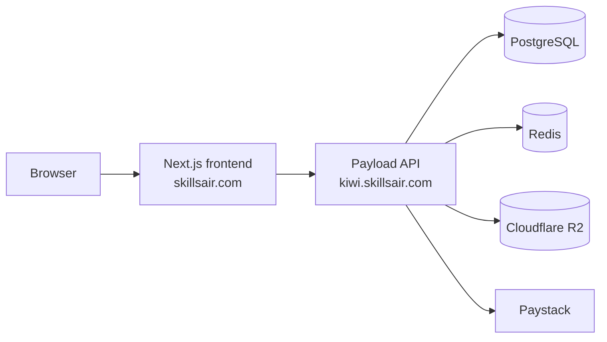

# SkillsAir on Contabo

The frontend and backend are separate Node services. The frontend keeps its same-origin `/api/*` routes as a browser-facing adapter; those routes call the Payload API at `SKILLSAIR_BACKEND_URL`. Authentication uses the backend's access and refresh tokens in HTTP-only cookies. Paystack initialization, verification, webhooks, and order fulfillment stay in the backend.

## Coolify services

Deploy the backend, database, and Redis first. Keep PostgreSQL and Redis private to the Coolify network; only the frontend and API should have public domains.

1. Create a PostgreSQL service and a Redis service in Coolify. Use their internal hostnames in the backend connection strings.
2. Create an application from the `skillsair-backend` repository. Select its `Dockerfile`, expose port `3001`, and assign `kiwi.skillsair.com`. Set its environment variables using that repository's `.env.example`.
3. Set backend URLs and origins to `BACKEND_URL=https://kiwi.skillsair.com`, `FRONTEND_URL=https://skillsair.com`, and `CORS_ORIGINS=https://skillsair.com,https://www.skillsair.com`. Use `DATABASE_URI` and `REDIS_URL` with the private service hostnames.
4. Set the backend secrets and integrations: `PAYLOAD_SECRET`, `JWT_SECRET`, Paystack keys and webhook secret, Resend credentials, R2 credentials, and Google Drive service-account credentials. Use strong, separate secrets for Payload and JWT.
5. Set `CERTIFICATE_PRICE_NGN=10000` to match the frontend certificate checkout price.
6. Wait for the backend health check at `https://kiwi.skillsair.com/health` to return `{"status":"ok"}`.
7. Create a separate Coolify application from the `skillsair` frontend repository. Select its `Dockerfile`, expose port `3000`, and assign `skillsair.com` (and `www.skillsair.com` if desired).
8. Set `SKILLSAIR_BACKEND_URL=https://kiwi.skillsair.com` as a runtime variable. Set `NEXT_PUBLIC_SITE_URL=https://skillsair.com` as a build-time variable (and runtime too if Coolify offers both), then deploy. `SKILLSAIR_BACKEND_URL` must be the backend origin only; do not append `/api` or a route path.

The frontend Dockerfile builds Next.js standalone output. Coolify runs that production build inside the image build. Course purchases use the backend's one-time payment endpoint by default; active course-specific subscription plans are shown as an explicit recurring option. Certificate payments also use the backend's payment endpoint. The backend creates the Paystack authorization URL and verifies the callback.

The included `docker-compose.yml` can run the frontend container by itself. The backend should be deployed from its own repository so Coolify can build it with its own Dockerfile and attach its Postgres and Redis services.

## Paystack

Configure the Paystack webhook to call `https://kiwi.skillsair.com/api/payments/webhook`. The frontend sends the selected payment option to the backend: bank-transfer checkout is restricted to Paystack's `bank_transfer` channel; the standard Paystack option leaves the provider's enabled channels available. Course and certificate callbacks return to `https://skillsair.com/payments/callback`; subscription callbacks return to `https://skillsair.com/subscriptions/callback`. Both routes ask the backend to verify the payment reference before showing the order.

## Data cutover

The code connection does not copy WordPress data. The backend repository provides import scripts described in its `MIGRATION.md` for users, media, courses, enrollments, orders, subscriptions, and learning progress. Export and normalize the existing records, run each importer in dry-run mode first, compare counts and samples, then import into the production database before directing users to the new app. Existing WordPress password hashes cannot be reused by these scripts; users will need to reset their passwords through the new backend.

Before switching DNS or announcing the new app, verify:

- `https://skillsair.com/api/courses?per_page=6` returns a `courses` array.
- A newly registered account can sign in and load its dashboard.
- An imported account can see its enrollments and course outline.
- A test Paystack transaction reaches the callback, verifies successfully, and creates access in the backend.
- A completed course can purchase a certificate and the certificate PDF opens from its stored media URL.
